# From "Sample Scarcity" to "Available Enhancement": Fault Diagnosis Model Based on CWT + Conditional DCGAN

Preface: In the task of small sample fault diagnosis, the most common challenge is not the insufficient complexity of the model but rather a highly imbalanced category distribution: while there are plenty of normal samples, especially fine-grained fault categories, the number of fault samples is extremely low. This leads to the model's tendency to favor the majority class during training and its instability in recognizing the minority class during testing.
This issue is addressed by introducing an innovative model: Firstly, convert one-dimensional vibration signals into continuous wavelet transform (CWT) time-frequency diagrams; then, for minority class samples, construct a conditional deep convolutional generative adversarial network (cDCGAN) for image enhancement; finally, design a data partitioning scheme to compare the performance on the real test set between the original training method and the enhanced training method.
Introduction to Small Sample/Imbalanced Datasets: Few samples, uneven classes? A comprehensive explanation of small sample & imbalanced samples in fault diagnosis!
In actual fault diagnosis tasks, many datasets exhibit the following characteristics:
1. The normal class samples far outnumber the fault class samples;
2. The differences between the minority classes are subtle, yet they differ significantly from the normal class;
3. The total amount of raw samples is limited, especially with very few true samples per fault category;
4. If classification models are directly trained, they tend to learn the "easiest-to-classify" normal class first, resulting in insufficient recognition ability for the minority fault categories.
The problem faced in this experiment is very typical: the number of normal class samples is significantly higher than other fault categories, and the real samples for multiple fault categories are extremely scarce. For such a data distribution, relying solely on conventional convolutional neural networks (CNN) training often results in two issues:
1. Overall Accuracy appears good, but the minority class is almost unrecognizable;
2. Test results are highly dependent on the data partitioning method, leading to poor stability.
Therefore, we hope to answer a core question: Can the recognition performance of minority faults be improved by using "time-frequency representation + generative enhancement" when there are few fault samples?
● Dataset: CWRU West Reserve University Bearing Dataset
● Environment Framework: Python 3.11, PyTorch 2.1 and above can be run.
● Usage Object: Beginners, those in need of papers, and those pursuing graduation projects.
● Code Guarantee: The code comments are detailed and ready to run.
Attention: We also provide a model explanation (facilitating learning of network architecture) and video tutorials! Students requiring graduation projects or writing small papers must see this. The modules are rich, innovative, and performance-optimized!!
1. Model Introduction
1.1 Introduction to CWT+Conditional DCGAN Model
The overall idea of this article can be summarized into three steps:
Step 1: Converting the original vibration signal to CWT time-frequency plot
\tIn the original time-domain waveform, local impact characteristics are difficult to be directly modeled.
\tFault modes are often reflected in the frequency band energy distribution and time-frequency joint structure.
\tCWT can simultaneously preserve both time and frequency information, which is suitable for subsequent learning with image models.
Step 2: Using Conditional DCGAN to generate augmented samples for the minority class. The core model used is: \tConditional DCGAN, which essentially combines Conditional Generative Adversarial Network (cGAN) with Deep Convolutional GAN (DCGAN).
1. From the "Conditional Mechanism" perspective, it is a cGAN: both the generator and discriminator incorporate class labels;
2. From the "Network Architecture" perspective, it is a DCGAN: both the generator and discriminator employ convolution/deconvolution architectures;
3. Therefore, the model is named Conditional DCGAN (cDCGAN). Unlike regular DCGAN, Conditional DCGAN not only generates a realistic image but also produces an image belonging to a specified category that is realistic.
4. Step 3: Designing a more reasonable data partitioning method to verify if the enhancement is effective
In small sample tasks, experimental results often depend not only on the model but also greatly on the data partitioning method. If all minority class true samples are placed in the test set while training only generates images, the model actually learns the "synthetic → real" cross-domain mapping, which will severely degrade test performance and is not conducive to fair evaluation of the effectiveness of the enhancement.
5. Therefore, this experiment compared various partitioning schemes and ultimately adopted a more reasonable improvement strategy: retaining the true test set while keeping minority class true samples in the training set and then supplementing with generated samples.
6. Bearing Data Loading and Preprocessing
6.1 Importing Data
6.1.1 Following previous articles, preprocessing for fault classification in the KSU bearing data 10-classification dataset:
6.1.2 Manually creating an imbalanced dataset containing 100 normal samples and 10 samples each from 9 fault classes:
7. Conversion of Fault Signals to Continuous Wavelet Transformation Time-frequency Images
8. Fault Generation Model Based on CWT+Conditional DCGAN
8.1 Definition of the generation network model, setting parameters, and training the model
8.2 Data Training and Generation Process
8.3 Data Generation
8.4 Model Comparison
1. Training Process of CNN (Original Distribution vs Data Generation)
2. Accuracy Comparison:
Experimental results show that, under the premise of maintaining the test set as real samples and the test distribution consistent with the original scheme, introducing minority class augmented samples leads to an increase in model accuracy from 0.7895 to 0.8158, and Macro-F1 from 0.5367 to 0.5967. This indicates that data augmentation is not just about "raising overall accuracy," but also brings positive gains to the average performance of categories. This demonstrates that the current augmentation strategy can alleviate some long tail category learning issues.
For fault diagnosis tasks with small samples, multiple categories, and long tail distributions, relying solely on original data training classification models often fails to achieve stable results. In this session, through a combination experiment of "CWT time-frequency representation + Conditional DCGAN minority class augmentation + reasonable data partitioning," we verified the practical role of generative augmentation in fault diagnosis. Under the premise of maintaining the test set's real sample distribution, introducing minority class augmented samples leads to improvements in multiple indicators such as Accuracy, Macro Recall, and Macro F1. This shows that the augmentation strategy not only improves overall performance but also somewhat enhances the average performance of categories. However, the benefits of augmentation are significantly different across categories, with some difficult classes still performing poorly, indicating that we need to continue focusing on "generative quality, augmentation ratio, and difficult class modeling" in the future.
End
2. Friends who like this can click to follow, give the article a "like", share it on WeChat Moments or discuss groups.
Previously excellent content:
Rapid publication papers | Based on 2D-SWinTransformer+1D-CNN-SENet parallel fault diagnosis model
Bearing life prediction major update! Added CNN-BiGRU-Attention model collection + rich visualization charts
Multimodal - Fault Diagnosis | Opening a New Era in Vision with Large Core Convolution!
Superior! Directly write in Zone One! The fault diagnosis model based on SSA+Informer-SENet.
Multi-source Information Fusion: Data layer fusion + feature layer fusion fault diagnosis model!

## Images

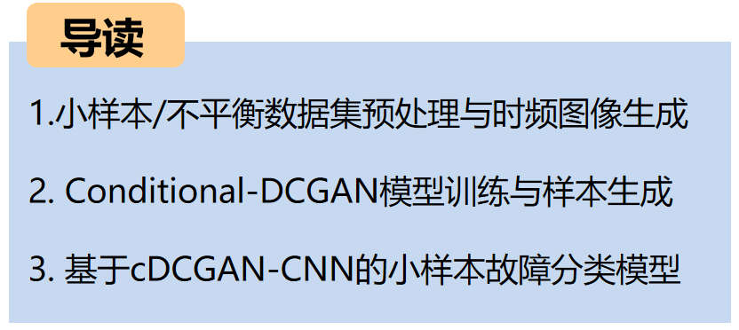

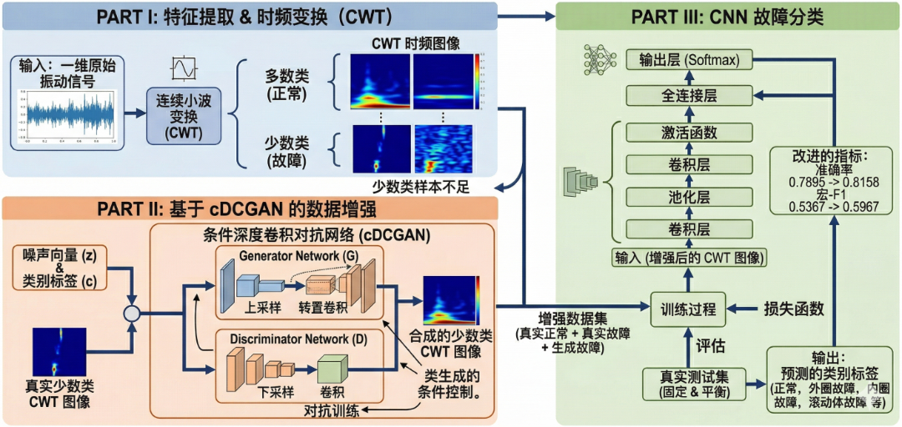
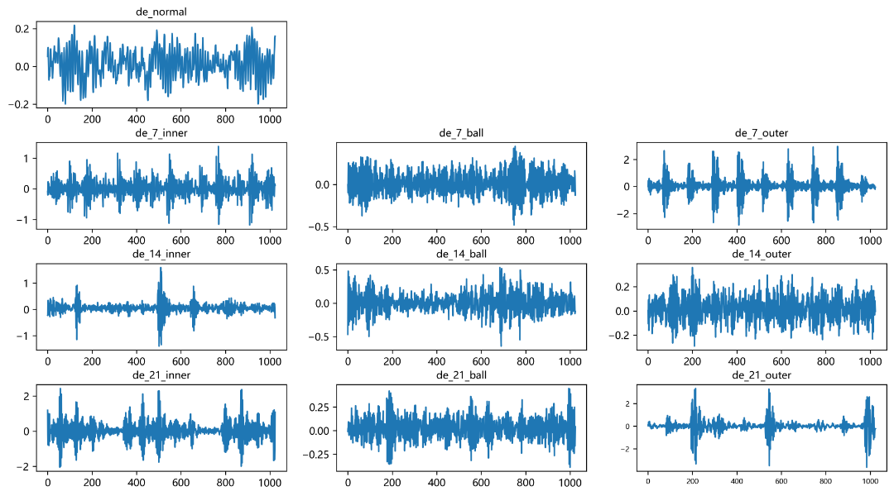
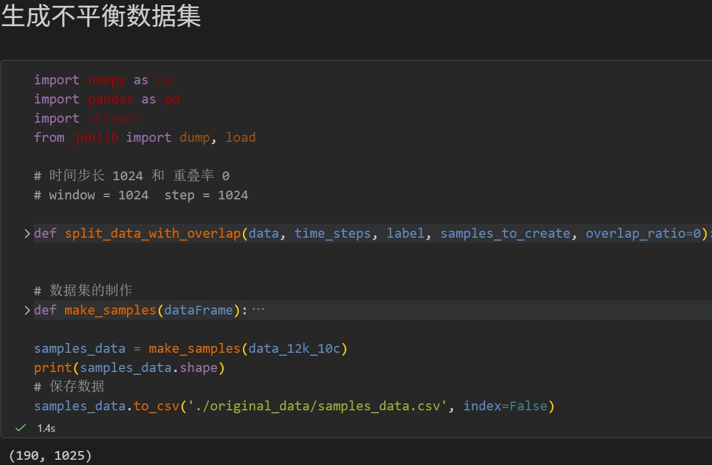
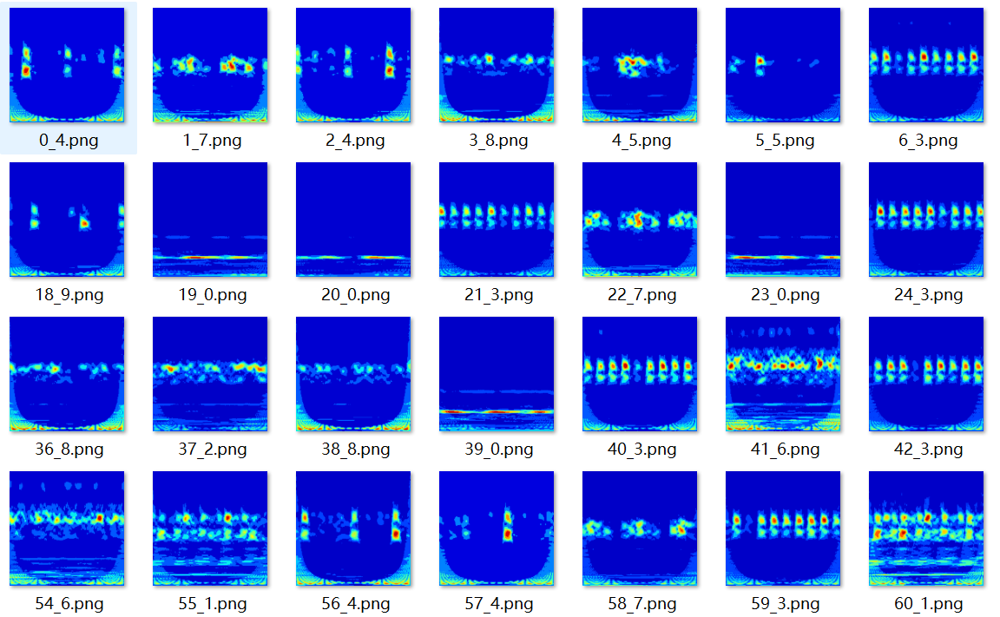
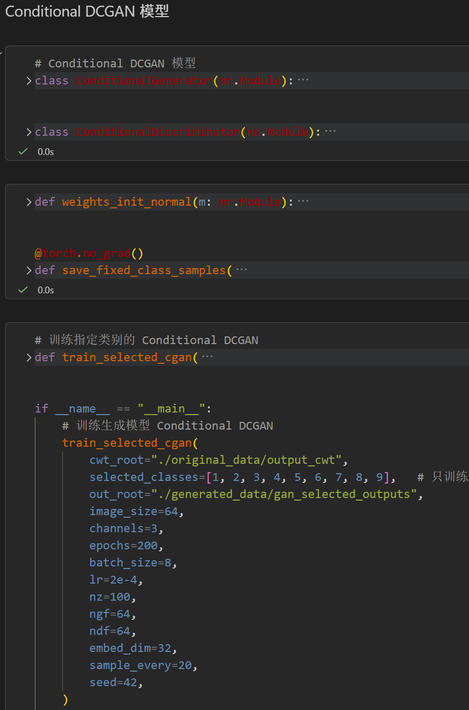
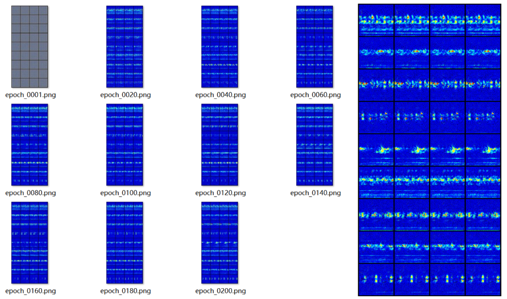
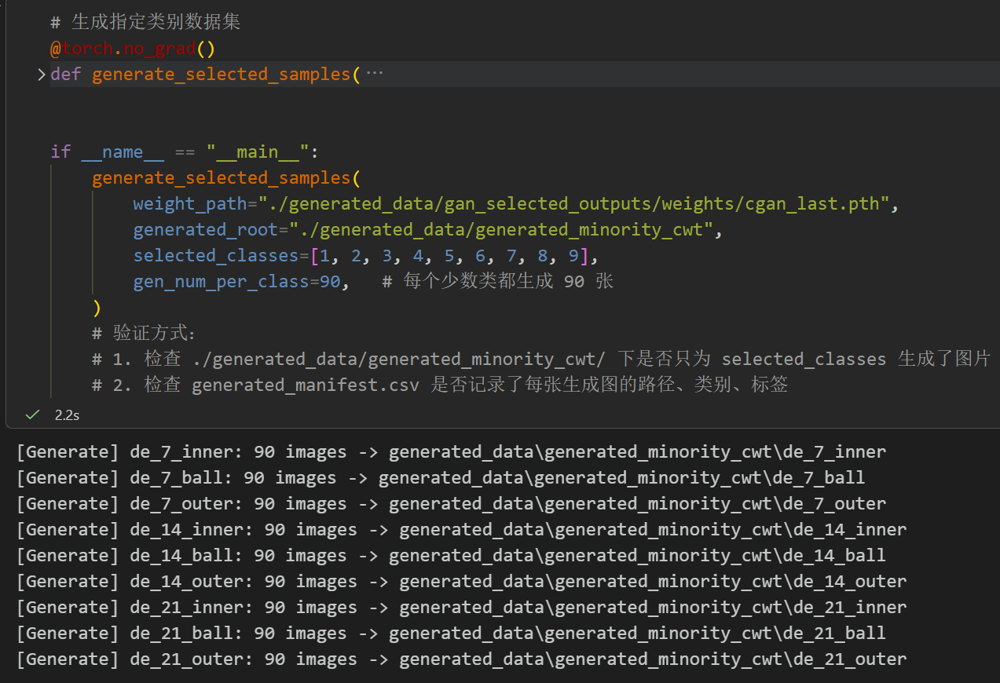
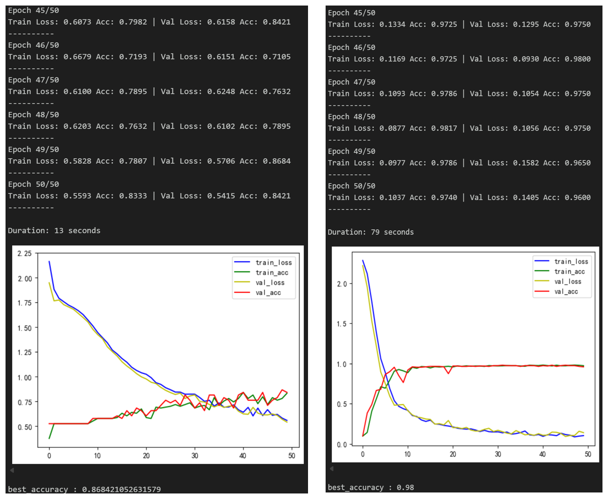
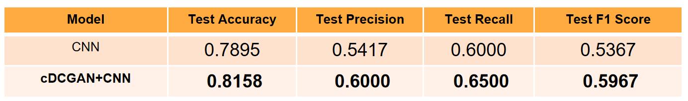
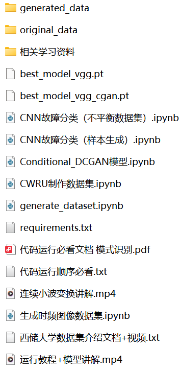

<!-- PAYMENT_BLOCK -->

## Get this dataset

- Payment link (Stripe): [Buy now](https://buy.stripe.com/3cs8yP7sY87d0vu9AB)
- Payment QR code: 

<!-- /PAYMENT_BLOCK -->
